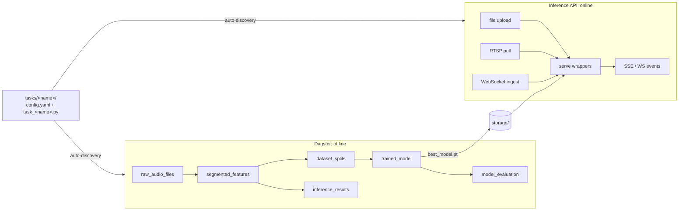

# Audio Ops Framework

Audio Ops is a Python framework for audio machine learning. You describe a
task in a `config.yaml`, and the framework provides feature extraction,
training, evaluation, batch scoring and a streaming inference API for it.

-   :material-rocket-launch: **[Quickstart](getting-started/quickstart.md)**

    Train and serve the bundled example with five commands. Synthetic data is
    included and no services are needed.

-   :material-puzzle: **[Write a task](getting-started/first-task.md)**

    Standard tasks need only a `config.yaml`. Add Python for the parts you want
    to change.

-   :material-graph: **[Capabilities](concepts/capabilities.md)**

    A task lists `train`, `evaluate`, `batch_infer` and/or `serve`, and only
    those stages are built.

-   :material-access-point: **[Streaming](guide/streaming.md)**

    File upload, RTSP and WebSocket input on one media clock, with results over
    Server-Sent Events.

## Background

The framework came out of applied research projects with very different audio:
crowd sentiment in football stadiums, speech in care settings, wake words,
cough detection. Each project needed the same work: cutting recordings into
segments, computing features, splitting data so that no recording ends up in
both train and test, a training loop, checkpoints, scoring folders of new
audio, and a low-latency service for live streams. Audio Ops does that work
once for all tasks.

- You don't edit the pipeline. A task is a folder with a `config.yaml`, plus
  Python only where it differs from the classification, regression or
  detection bases.
- A task declares its capabilities and gets exactly those stages. A model that
  only serves adds no Dagster assets, and a project that only trains never
  starts the API.
- Batch inference and the streaming service compute features with the same
  extractor, window and input shaping as training.
- No services are required. By default it uses local disk, SQLite for
  tracking and no metrics backend. S3/MinIO, InfluxDB, an MLflow server, an
  LLM and the fusion timeline are enabled with environment variables.

## Related tools

Speech toolkits such as SpeechBrain, NeMo and Hugging Face provide models.
Dagster, MLflow and BentoML provide general pipelines and serving. Audio Ops
sits between them and is meant for analysing live audio streams and retraining
the models that do it. It is not a voice bot framework like Pipecat. See
[Comparison with other tools](concepts/why-audio-ops.md).

Audio Ops has been used in [GRASS](project/used-in.md#grass) (crowd sentiment
in Dutch football stadiums) and [AI-ZI](project/used-in.md#ai-zi) (explainable
AI for care and industry), two applied research projects at Saxion University
of Applied Sciences.

## Overview

The two runtimes only share the task definitions and the artifact layout.
Dagster writes checkpoints and the API reads them. Neither imports the other's
internals, so you can deploy them separately.

## License

Apache-2.0. See [License & notices](project/license.md).
